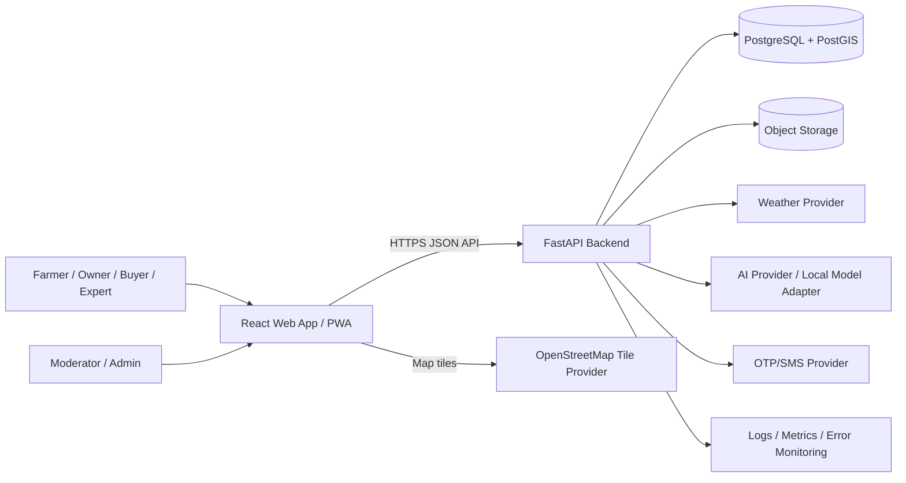
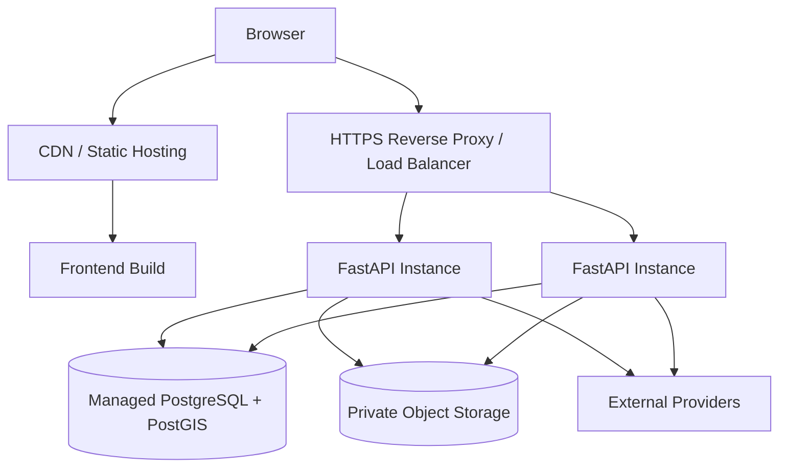

# System Architecture

## Shikhor AI — Separate Frontend and Backend

**Document version:** 1.0  
**Architecture style:** Separate deployable frontend and backend, modular monolith backend for MVP  
**Primary stack:** React + TypeScript + Tailwind CSS; Python + FastAPI; PostgreSQL + PostGIS

---

## 1. Architecture Goals

- Keep frontend and backend independently deployable.
- Support mobile-first, Bangla-first, low-connectivity workflows.
- Provide clear authorization boundaries for farmers, owners, buyers, experts, moderators, and admins.
- Avoid premature microservices while preserving module boundaries.
- Make external AI, weather, maps, SMS, and storage providers replaceable.
- Protect personal, location, messaging, and crop-image data.
- Ensure offline requests can synchronize safely without duplicates.
- Scale the expensive image-analysis path independently when usage justifies it.

---

## 2. Recommended Repository Structure

Use two repositories or two top-level applications in a controlled monorepo. Separate deployment pipelines are mandatory either way.

```text
shikhor-ai/
├── frontend/                 # React application
│   ├── src/
│   ├── public/
│   ├── tests/
│   ├── Dockerfile
│   └── package.json
├── backend/                  # FastAPI application
│   ├── app/
│   ├── migrations/
│   ├── tests/
│   ├── Dockerfile
│   └── pyproject.toml
├── contracts/                # OpenAPI snapshots and shared examples
├── docs/
└── .github/workflows/
```

If separate repositories are preferred, publish a versioned OpenAPI contract from the backend and generate a typed frontend client in CI.

---

## 3. High-Level Context



The browser must not call AI, weather, SMS, or private storage providers with secret credentials. Those calls go through the backend.

---

## 4. Frontend Architecture

### 4.1 Technology

- React + TypeScript
- Vite for the application build unless server rendering becomes a confirmed SEO requirement
- React Router
- Tailwind CSS
- Framer Motion with reduced-motion support
- TanStack Query for server state
- React Hook Form + Zod for forms
- i18next or a typed locale dictionary
- Dexie.js over IndexedDB for offline data
- Workbox or Vite PWA plugin for service-worker lifecycle
- Leaflet + OpenStreetMap for maps
- Lucide React for icons

The public marketing pages can be statically pre-rendered if SEO testing shows the need. Do not move business authorization into the frontend.

### 4.2 Frontend module layout

```text
src/
├── app/                      # bootstrap, router, providers
├── routes/                   # route-level components
├── features/
│   ├── auth/
│   ├── crop-assistant/
│   ├── equipment/
│   ├── weather/
│   ├── marketplace/
│   ├── messaging/
│   ├── knowledge/
│   ├── offline-sync/
│   └── admin/
├── components/               # shared UI components
├── design-system/            # tokens and primitives
├── api/                      # generated client and interceptors
├── db/                       # IndexedDB schema and migrations
├── i18n/
├── hooks/
├── lib/
├── types/
└── test/
```

### 4.3 State ownership

- **Server state:** TanStack Query; invalidate by domain event/action.
- **Form state:** React Hook Form.
- **Local UI state:** component state or a small context/store.
- **Offline durable state:** IndexedDB.
- **Authentication:** prefer secure, HTTP-only cookies if frontend/backend deployment and CSRF design allow; otherwise use short-lived in-memory access tokens and tightly controlled refresh handling.

Do not duplicate server records across global frontend stores without a reconciliation strategy.

### 4.4 Routing

```text
Public:       /, /features, /about, /contact, /login, /signup
Farmer app:   /app, /app/crop-assistant, /app/equipment, /app/weather,
              /app/buyers, /app/knowledge, /app/messages, /app/offline-queue
Owner app:    /app/my-equipment, /app/rental-requests
Buyer app:    /app/crop-listings, /app/saved-searches
Admin:        /admin/*
```

Route guards improve UX but never replace backend authorization.

### 4.5 PWA and offline model

Cache categories:

- **Precache:** application shell, fonts, icons, core locale files
- **Stale-while-revalidate:** public knowledge metadata and previously read approved articles
- **Network-first:** authenticated profiles and current marketplace data
- **Never general-cache:** tokens, private conversations, admin data, raw AI submissions unless explicitly designed

IndexedDB stores:

- downloaded knowledge articles and version metadata
- user-selected location reference data
- disease-history summary only if policy permits
- queued rental requests/messages
- synchronization metadata and idempotency keys

Every queued command includes:

```json
{
  "localId": "uuid",
  "idempotencyKey": "uuid",
  "operation": "rental_request.create",
  "payload": {},
  "createdAt": "ISO-8601",
  "retryCount": 0,
  "status": "queued"
}
```

Sync behavior:

1. Attempt only after authentication and connectivity checks.
2. Send the idempotency key with the command.
3. Mark synced only after a 2xx response containing the server record ID.
4. Use exponential backoff with jitter for temporary failures.
5. Stop and show action-required status for validation, authorization, or conflict errors.
6. Never retry file uploads indefinitely in the background without user visibility.

Background Sync is an enhancement, not the only mechanism; provide foreground retry because browser support varies.

---

## 5. Backend Architecture

### 5.1 Technology

- Python 3.12+
- FastAPI
- Pydantic v2
- SQLAlchemy 2.x
- Alembic migrations
- PostgreSQL 16+ with PostGIS
- HTTPX for outbound provider calls
- Argon2id password hashing when passwords are used
- Pytest for tests
- Structured logging with request correlation IDs

### 5.2 Modular-monolith structure

```text
app/
├── main.py
├── core/                     # settings, logging, security, errors
├── db/                       # session, base, migrations integration
├── common/                   # shared value objects and utilities
├── modules/
│   ├── auth/
│   ├── users/
│   ├── geography/
│   ├── crop_assistant/
│   ├── equipment/
│   ├── rentals/
│   ├── weather/
│   ├── crop_marketplace/
│   ├── messaging/
│   ├── knowledge/
│   ├── moderation/
│   └── audit/
├── integrations/
│   ├── ai/
│   ├── weather/
│   ├── sms/
│   └── storage/
├── api/
│   ├── dependencies.py
│   └── v1/
└── tests/
```

Each module owns its API routes, application services, database models, schemas, and policies. Cross-module access should go through services rather than direct model manipulation.

### 5.3 API style

- Base path: `/api/v1`
- JSON request/response for normal operations
- `multipart/form-data` only for uploads
- OpenAPI is the contract source
- Cursor pagination for conversations and high-volume feeds
- Stable error envelope
- Request correlation ID returned in response headers
- Idempotency key required for offline-created commands

Example error:

```json
{
  "error": {
    "code": "RENTAL_DATE_UNAVAILABLE",
    "message": "The equipment is not available for the selected date.",
    "fieldErrors": {},
    "requestId": "uuid"
  }
}
```

### 5.4 Initial endpoint groups

```text
POST   /api/v1/auth/register
POST   /api/v1/auth/login
POST   /api/v1/auth/firebase-login
POST   /api/v1/auth/google-login
POST   /api/v1/auth/forgot-password/request
POST   /api/v1/auth/forgot-password/verify
POST   /api/v1/auth/forgot-password/reset
POST   /api/v1/auth/refresh
POST   /api/v1/auth/logout
GET    /api/v1/auth/me
POST   /api/v1/auth/onboarding

POST   /api/v1/crop-cases
GET    /api/v1/crop-cases
GET    /api/v1/crop-cases/{id}
POST   /api/v1/crop-cases/{id}/feedback

GET    /api/v1/equipment
POST   /api/v1/equipment
PATCH  /api/v1/equipment/{id}
DELETE /api/v1/equipment/{id}
POST   /api/v1/rental-requests
GET    /api/v1/rental-requests
PATCH  /api/v1/rental-requests/{id}/status

GET    /api/v1/weather/forecast
GET    /api/v1/weather/plan

GET    /api/v1/crop-listings
POST   /api/v1/crop-listings
PATCH  /api/v1/crop-listings/{id}

GET    /api/v1/conversations
POST   /api/v1/conversations
GET    /api/v1/conversations/{id}/messages
POST   /api/v1/conversations/{id}/messages

GET    /api/v1/knowledge/articles
GET    /api/v1/knowledge/articles/{slug}
POST   /api/v1/reports
```

### 5.5 Background processing

MVP principle: keep the web process responsive, but do not add distributed infrastructure without need.

- Fast, deterministic actions execute in the request.
- Image preprocessing/inference may initially use an in-process bounded executor only for a small pilot.
- Before wider production, move long-running or retryable AI jobs to a durable worker queue.
- Redis and a task worker (for example Celery/RQ/Arq) are optional infrastructure introduced when measured load or reliability requires them.
- A database-backed jobs table is acceptable for an early controlled pilot if locking, retries, dead-letter state, and monitoring are implemented correctly.

Do not rely on FastAPI `BackgroundTasks` for business-critical durable jobs.

---

## 6. Data Architecture

### 6.1 Core entities

- `users`
- `user_roles`
- `farmer_profiles`
- `owner_profiles`
- `buyer_profiles`
- `expert_profiles`
- `locations`
- `crop_cases`
- `crop_case_images`
- `crop_case_predictions`
- `crop_case_feedback`
- `equipment`
- `equipment_availability`
- `rental_requests`
- `crop_listings`
- `conversations`
- `conversation_participants`
- `messages`
- `knowledge_articles`
- `knowledge_versions`
- `reports`
- `moderation_actions`
- `refresh_sessions`
- `idempotency_records`
- `audit_logs`

### 6.2 Location model

Use PostGIS `geography(Point, 4326)` for latitude/longitude requiring earth-distance queries. Store a human-readable district/upazila reference separately.

- Create a GiST index on geography columns.
- Filter with `ST_DWithin` before calculating distance.
- Use KNN ordering where appropriate for nearest-neighbor queries.
- Reduce exposed precision for public listings.

PostGIS supports indexed nearest-neighbor ordering via its distance operators: <https://postgis.net/docs/geometry_distance_knn.html>.

### 6.3 Equipment ranking

For results with the same equipment type and compatible price unit:

```text
price_score    = normalized price in candidate set, 0 = lowest
 distance_score = normalized distance in search radius, 0 = nearest
 ranking_score  = (0.65 × price_score) + (0.35 × distance_score)
```

Rules:

- Filter unavailable, paused, unverified-if-required, or out-of-radius records first.
- Convert only compatible price units; never compare per-hour directly with per-acre without an approved conversion.
- Handle equal min/max values without division by zero.
- Return ranking components to support transparent UI.
- Unit-test ordering, edge cases, and missing data.

### 6.4 Database constraints

- Foreign keys on all relationships
- Unique constraints for phone/email normalization as applicable
- Check constraints for latitude, longitude, price, quantity, and allowed state transitions where practical
- Partial unique indexes for active sessions/idempotency where useful
- Timestamps in UTC
- Soft deletion only where recovery/audit is needed; otherwise use explicit archival rules

---

## 7. AI Architecture

### 7.1 Provider abstraction

Create an interface such as:

```python
class CropAnalysisProvider(Protocol):
    async def analyze(self, request: CropAnalysisRequest) -> CropAnalysisResult: ...
```

Adapters may include:

- Local TensorFlow/PyTorch vision model
- Classical Scikit-learn NLP intent classifier
- Gemini or Claude for constrained language assistance

Use one approved provider per function in production. Do not call multiple paid models by default unless evaluation proves a benefit.

### 7.2 Analysis pipeline

1. Validate file type and byte signature.
2. Strip unsafe metadata and create a normalized image derivative.
3. Validate crop/category and user input.
4. Run the approved vision/NLP pipeline.
5. Map raw model output to an approved disease/condition taxonomy.
6. Apply confidence and unsupported-case rules.
7. Retrieve reviewed guidance content.
8. Generate a structured result; do not let a language model invent pesticide dosage.
9. Store model/version, confidence, latency, and feedback linkage.
10. Return transparent limitations and escalation.

### 7.3 AI response schema

```json
{
  "status": "possible_match | uncertain | unsupported | failed",
  "possibleCondition": "string or null",
  "confidence": 0.0,
  "confidenceBand": "high | medium | low",
  "reasonSummary": ["string"],
  "guidance": ["reviewed knowledge item"],
  "escalationRecommended": true,
  "modelVersion": "string",
  "disclaimer": "string"
}
```

Model evaluation, threshold approval, and expert review are release gates. Accuracy must not be claimed without a representative test set.

---

## 8. External Integrations

### Weather

- Backend adapter with timeout, retry budget, quota monitoring, cache, and circuit breaker behavior
- Cache by coarse location and forecast period
- Store provider timestamp and attribution
- Mark stale data in the API response

### Maps

- Leaflet renders map tiles in the frontend.
- Follow the selected tile provider's usage policy and attribution rules.
- Use backend geospatial queries for equipment search.
- Do not expose exact private home coordinates publicly.

### Object storage

- Use S3-compatible private object storage or equivalent.
- Generate short-lived signed URLs for authorized reads.
- Separate original uploads from sanitized derivatives.
- Apply retention and deletion policies.

### SMS/OTP

- Provider adapter with strict attempt limits and abuse monitoring.
- Store hashed OTP values, not plaintext.
- Do not reveal whether a phone number exists in password recovery responses.

---

## 9. Authentication and Authorization

- Short-lived access credential and rotating refresh session.
- Store refresh-session records server-side so revocation is possible.
- Enforce RBAC plus object-level ownership checks.
- Admin and moderator routes require explicit policy checks.
- Sensitive actions may require recent authentication.
- Rate-limit login, refresh, OTP, crop analysis, messaging, and search endpoints.

FastAPI provides OAuth2/JWT building blocks, but the application remains responsible for correct session, revocation, authorization, and storage design: <https://fastapi.tiangolo.com/tutorial/security/oauth2-jwt>.

---

## 10. Deployment Architecture

### Environments

- Local
- Development
- Staging
- Production

Each environment has separate databases, object-storage buckets/containers, credentials, and provider keys.

### Runtime



For the pilot, one API instance may be acceptable if rollback, backups, and monitoring exist. Production scale-out requires stateless API instances and shared persistence.

### CI/CD

Frontend pipeline:

1. Install with locked dependencies
2. Lint, type-check, unit test
3. Build production bundle
4. Run accessibility/smoke tests
5. Dependency and secret scan
6. Deploy preview/staging
7. Manual approval for production

Backend pipeline:

1. Install locked Python dependencies
2. Ruff/format/type checks
3. Unit and integration tests
4. Migration validation
5. OpenAPI compatibility check
6. SAST/dependency/secret scan
7. Build signed/traceable image
8. Deploy staging and smoke test
9. Backup/rollback check, then production approval

Migrations run as a controlled release step, not concurrently from every API replica.

---

## 11. Observability

- Structured JSON logs
- Request ID/correlation ID
- Metrics: request count, error rate, latency, DB pool, provider latency/failure, AI queue depth, sync outcomes
- Distributed tracing only if the operational benefit justifies it
- Error monitoring with PII scrubbing
- Alerts based on user impact, not every single exception
- Audit log for authentication events and privileged changes

Never log passwords, tokens, OTPs, raw authorization headers, full private messages, or unredacted sensitive images.

---

## 12. Testing Strategy

### Frontend

- Unit tests for ranking display, sync state machine, locale formatting, and validation
- Component tests for forms and accessibility
- End-to-end flows for signup, crop case, equipment request, offline queue, and moderation
- Responsive checks at 390px, 768px, 1280px
- Service-worker update and stale-cache tests

### Backend

- Unit tests for policies, ranking, weather rules, and state transitions
- Integration tests with PostgreSQL/PostGIS
- Contract tests from OpenAPI
- Authorization matrix tests for every role and resource
- File upload validation tests
- Idempotency and duplicate-delivery tests
- Provider timeout/failure tests
- Migration forward/rollback tests where safe

### AI

- Representative holdout dataset
- Per-class precision/recall and confusion matrix
- Evaluation by crop, image quality, region/season where data permits
- Out-of-distribution and unsupported-image tests
- Human review of guidance safety
- Regression testing by model version

---

## 13. Architecture Decisions

### ADR-001 — Separate frontend and backend

**Decision:** Independently deploy React frontend and FastAPI backend.  
**Reason:** Clear security boundary, independent scaling/deployment, typed API contract.

### ADR-002 — Modular monolith first

**Decision:** One backend deployment with domain modules.  
**Reason:** Lower operational complexity while the product and traffic are uncertain.

### ADR-003 — PostgreSQL + PostGIS

**Decision:** Use one transactional database with geospatial support.  
**Reason:** Strong consistency for marketplace/messaging metadata and efficient location queries.

### ADR-004 — Provider adapters

**Decision:** External AI, weather, SMS, and storage integrations sit behind interfaces.  
**Reason:** Avoid vendor lock-in and simplify testing/failure handling.

### ADR-005 — IndexedDB command queue

**Decision:** Store offline commands locally with idempotency keys.  
**Reason:** Supports weak connectivity while preventing duplicate server actions.

---

## 14. References

- FastAPI deployment concepts: <https://fastapi.tiangolo.com/deployment/>
- FastAPI security: <https://fastapi.tiangolo.com/tutorial/security/>
- PWA offline data: <https://web.dev/learn/pwa/offline-data>
- IndexedDB state guidance: <https://web.dev/articles/indexeddb-best-practices-app-state>
- PostGIS spatial queries: <https://postgis.net/docs/using_postgis_query.html>
- PostGIS KNN distance: <https://postgis.net/docs/geometry_distance_knn.html>
